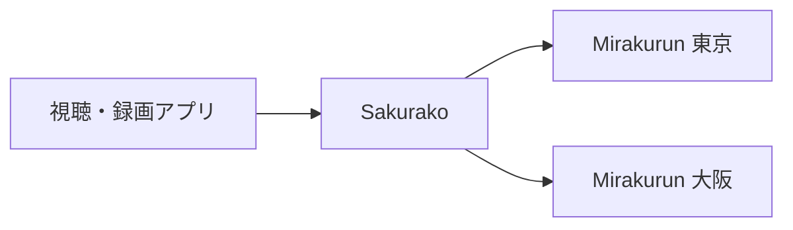

[](https://github.com/multiverse2011/sakurako)

# Sakurako

複数の [Mirakurun](https://github.com/Chinachu/Mirakurun) を、1 つの接続先にまとめるゲートウェイです。
地域ごとに設置した Mirakurun のチャンネルや番組表を、同じアプリから利用できます。



## 必要なもの

- 設定済みの Mirakurun
- Docker Compose（Go で直接動かす場合は「[開発](#開発)」を参照）

## 導入

以下を `sakurako.json` として保存し、URL を各 Mirakurun の接続先に変更します。

```json
{
  "backends": [
    {"id": "tokyo", "url": "http://192.168.1.10:40772/api"},
    {"id": "osaka", "url": "http://192.168.2.10:40772/api"}
  ]
}
```

同じディレクトリに `compose.yml` を作ります。

```yaml
services:
  sakurako:
    image: ghcr.io/multiverse2011/sakurako:latest
    restart: unless-stopped
    volumes:
      - ./sakurako.json:/etc/sakurako/sakurako.json:ro
    ports:
      - "127.0.0.1:40772:40772"
```

```sh
docker compose up -d
```

同じホストのアプリからは `http://localhost:40772` に接続できます。同じ Compose 内のアプリからは `http://sakurako:40772` を指定します。
ホスト側のポートが Mirakurun と重なる場合は、`127.0.0.1:40773:40772` などに変更してください。

管理画面は `http://localhost:40772/ui/`、API ドキュメントは `/ui/docs.html` で開けます。

## 設定

設定は `sakurako.json` に記述します。変更後は `docker compose restart sakurako` で再起動してください。

| 項目 | 既定値 | 説明 |
| --- | --- | --- |
| `listen` | `:40772` | 待ち受けるアドレスとポート |
| `backends[].id` | 必須 | 接続先の一意の名前。英数字・`_`・`-` が使用可能 |
| `backends[].url` | 必須 | Mirakurun の API URL（末尾に `/api`） |
| `backends[].priority` | `0` | 配信元の優先度。0 以上で、大きい値を優先 |
| `backends[].service_domain` | 接続先ごとに区別 | 同じ放送を提供する接続先を冗長化する場合に、同じ値を指定 |
| `channel_names` | `virtual` | チャンネル名に接続先の ID を付加。`upstream` で元の名前を使用 |
| `sync_seconds` | `30` | 番組情報などの同期間隔（秒） |
| `catalog_timeout_seconds` | `20` | 接続先ごとの情報取得の制限時間（秒） |
| `max_stale_seconds` | `3600` | 最後に取得できた情報の有効期間（秒） |
| `stream_timeout_seconds` | `30` | 配信の接続・読み書きの制限時間（秒） |

`max_stale_seconds` は `sync_seconds + catalog_timeout_seconds` 以上にします。[設定例](sakurako.example.json)も参照してください。

`channel_names` に `upstream` を指定すると、接続先が違っても同じ名前のチャンネルは 1 つにまとまります。同じ `service_domain` を設定した接続先どうしで、同じ名前のチャンネルが別の放送（`networkId` が異なる）を指している場合、そのチャンネルは優先度が最も高い接続先と同じ `networkId` のソースだけを残します（同じ放送の予備はそのまま使えます）。別の放送へは切り替えず、優先度が最も高い接続先の情報が古くなった場合も、同じ `networkId` の予備が使えなければそのチャンネルの配信を止めます。同じ `service_domain` に同じ放送の予備が無ければ、別の `service_domain` にある同名チャンネルにも切り替えません。この競合は `/healthz` の `conflicting_channels` とログに表示され、`conflicting_service_ids` と同じく `/healthz` は 503（`ready: false`）になります。

競合の判定には、最後に取得できたサービス情報を持つ接続先をすべて使います。そのため次の制約があります。

- BS/CS では `networkId` が多くの放送で共通なので、別の放送を指していてもこの仕組みでは検出できません。実質的には GR 向けの保護です。
- sakurako の起動直後、優先度が最も高い接続先からまだ一度もサービス情報を取得できていない場合は、競合を検出できません。

## 仕組み

- **情報の集約**：各 Mirakurun のサービス・番組情報を定期的に取得します。チャンネル名は `tokyo-3237` のように接続先ごとに区別します。
- **配信元の選択**：接続先の状態と `priority` に応じて選びます。チューナーの割り当てやデコードは Mirakurun が行います。
- **配信の共有**：同じ放送への要求は、条件が合えば Mirakurun への 1 接続にまとめます。
- **状態の確認**：管理画面で接続状況・転送レート・設定・ログを確認できます。同期状態や ID の競合は `/healthz` でも確認できます。

## 制限事項

- Mirakurun のすべての API に対応しているわけではありません。対応範囲は [OpenAPI 定義](openapi.yml)を参照してください。
- 異なる `service_domain` で同じ `networkId`・`serviceId` が見つかると、該当するサービスと番組を除外します。同じ放送であることを確認したうえで `service_domain` を揃えてください。
- 認証・TLS 終端・利用数制限はありません。管理画面には設定やログも表示されるため、信頼できるネットワーク内で使用してください。

## 開発

Go 1.27.3 以上が必要です。

```sh
go build -o sakurako .
./sakurako -config sakurako.json
```

テスト：

```sh
go test -race ./...
go vet ./...
```

API 定義は `internal/apidocs/spec.go` を編集し、`go generate ./...` で更新します。
Mirakurun のモックは `go run ./cmd/mockmirakurun -h` を参照してください。

## ライセンス

[MIT](LICENSE)。同梱の Scalar も MIT ライセンスです。
